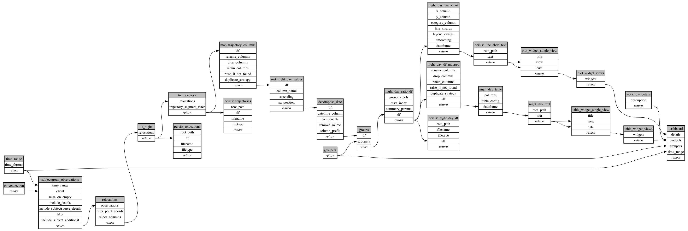

```
# AUTOGENERATED BY ECOSCOPE-WORKFLOWS; see fingerprint in README.md for details

```

```yaml
# fingerprint:
artifacts_sha256_basic: 177fc2d7842a734e23a4e110d0876227ef437a39c80a3e39bfb0b521473cf60b
artifacts_sha256_strict: 9aaad6d5c149a44197b4d89ece2ae22eab2d9317a018cc428558bbfc77b2676f
installed_requirements:
- channel: https://repo.prefix.dev/ecoscope-workflows/
  name: ecoscope-platform
  version: {version: ==2.25.3}
- channel: https://repo.prefix.dev/ecoscope-workflows-custom/
  name: ecoscope-workflows-ext-custom
  version: {version: ==0.1.0rc14}
- channel: conda-forge
  name: pydeck
  version: {version: ==0.9.2}
- channel: https://repo.prefix.dev/ecoscope-workflows-custom/
  name: ecoscope-workflows-ext-wwf-virunga
  version: {version: ==1.0.0}
params_sha256: cc23814a2df67e471e66a596820136569b1f8364312e1d9dbfa5b00236e1bfdb
spec_sha256: 965046a8aec0487eaa7bf2828b9a4122c8ee7342bac62c5ad95f24c9436ca8cc

```

# ecoscope-workflows-subject-day-night-location-map-2-workflow


