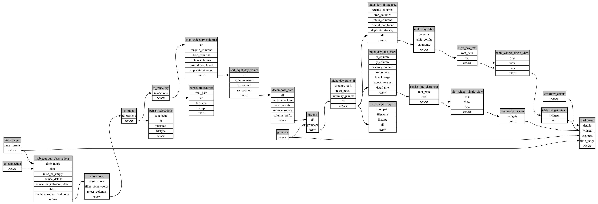

```
# AUTOGENERATED BY ECOSCOPE-WORKFLOWS; see fingerprint in README.md for details

```

```yaml
# fingerprint:
artifacts_sha256_basic: 61a8f5017a9df26c686049dbaf11889524cf0d0af90a05bc401ac36bc776264b
artifacts_sha256_strict: 2928eb465d6c67203bd8fb00a3597b5b55a7ac18c70603fbb7c24eba6290b317
installed_requirements:
- channel: https://repo.prefix.dev/ecoscope-workflows/
  name: ecoscope-platform
  version: {version: ==2.25.3}
- channel: https://repo.prefix.dev/ecoscope-workflows-custom/
  name: ecoscope-workflows-ext-custom
  version: {version: ==0.1.0rc14}
- channel: conda-forge
  name: pydeck
  version: {version: ==0.9.2}
params_sha256: b755f5e5876df8d41174a71f06ec2bfe4dc81f299c097946eaae271e1cf25ad6
spec_sha256: 20bcefc2c1e4414af0a42ce3eb6783ee64a87f52cb191b6f1d6a06b67aae7881

```

# ecoscope-workflows-subject-night-day-plot-workflow


